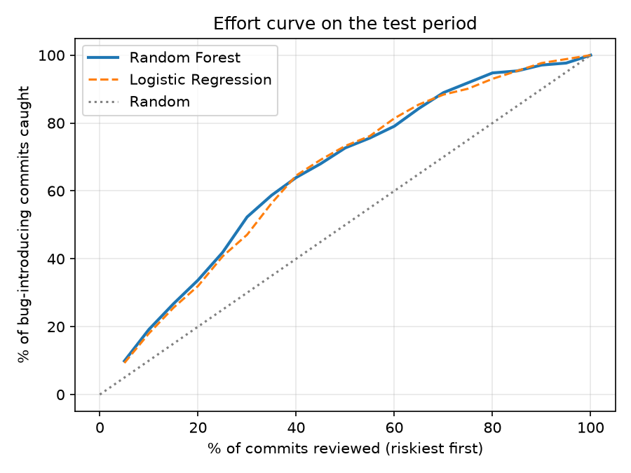
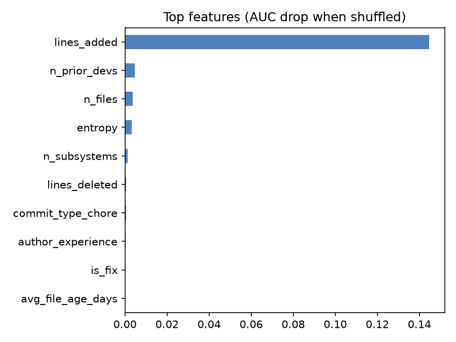

# Commit Risk Predictor

[](https://github.com/marjorymell/commit-risk-predictor/actions/workflows/ci.yml)
[](https://huggingface.co/spaces/marjorymel/commit-risk-predictor)


Predicts how likely a commit is to introduce a bug, so QA can **prioritise where to test** in each release.

**[Try the live demo →](https://huggingface.co/spaces/marjorymel/commit-risk-predictor)**

This is *Just-in-Time defect prediction* ([Kamei et al., 2013](https://doi.org/10.1109/TSE.2012.70)):
learn from a repository's own history which kinds of changes tend to need a fix later.
The model is trained on the full git history of [vtex/faststore](https://github.com/vtex/faststore),
an open-source e-commerce framework (React/TypeScript monorepo).

## Results

Evaluated on commits the model never saw, from a later period than the training data
(train: 2020-06 → 2024-04, test: 2024-04 → 2026-05, 2,141 labeled commits).

| Model | ROC AUC | Bug-introducing commits caught by reviewing the riskiest 30% |
|---|---|---|
| Random Forest | **0.76** | **52%** |
| Logistic Regression (baseline) | 0.75 | 48% |
| Random order | 0.50 | 30% |

<p>
  
  
</p>

**Takeaways**

- Reviewing the riskiest 30% of commits catches about half of the bug-introducing ones.
- The baseline nearly matches the Random Forest: the signal is in the features, not in model
  complexity. That is why the [demo](https://huggingface.co/spaces/marjorymel/commit-risk-predictor)
  ships the logistic regression, exported to JSON and evaluated in the browser.
- `lines_added` dominates. Part of that is real (big changes are riskier) and part is a known
  bias of SZZ labels: a commit that writes more lines has more lines that a later fix can touch.

## How it works

```
git history ──► SZZ labeling ──► features ──► temporal split ──► models ──► CLI / browser demo
```

1. **Labels (SZZ).** For every `fix:` commit, `git diff` finds the lines it changed and
   `git blame` on its parent finds who wrote them. Those commits are labeled *bug-introducing*
   ([Śliwerski, Zimmermann & Zeller, 2005](https://doi.org/10.1145/1082983.1083147)).
2. **Features.** Size and spread of the change (lines, files, packages, entropy), history of the
   touched files (previous changes, previous fixes, number of developers, age) and author
   experience. Each commit is described **using only its past**, to avoid data leakage.
3. **Evaluation.** Training uses the oldest 80% of commits and testing the newest 20%, never
   shuffled. The last 180 days are dropped because their bugs may not have been found yet.

## Usage

```bash
git clone https://github.com/marjorymell/commit-risk-predictor.git
cd commit-risk-predictor
python -m venv .venv && source .venv/bin/activate   # Windows: .venv\Scripts\activate
pip install -e ".[dev]"
```

```bash
# 1. Build the dataset from any git repository (data/faststore_commits.csv is already included)
git clone https://github.com/vtex/faststore.git ../faststore
commit-risk-extract ../faststore data/faststore_commits.csv

# 2. Train, evaluate and export the browser model
commit-risk-train data/faststore_commits.csv

# 3. Score a commit
commit-risk-predict ../faststore 41516034fd
```

```
Commit:  41516034fd  feat(api): add preserveCartLines flag to keep Checkout cart lines apar
Risk of introducing a bug: 75%  [HIGH]

  Change:   +508 / -18 lines in 8 files (1 test files), 2 subsystem(s)
  History:  touched files had 198 previous changes and 54 previous fixes
  Author:   1 previous commits in this repo
```

The extractor works on any repository that uses [Conventional Commits](https://www.conventionalcommits.org/)
(`fix: ...`), so you can retrain it on your own project.

## Project structure

```
src/commit_risk/
├── git_history.py   read commits and changed files from git log
├── classify.py      rules for code/test files and commit types
├── szz.py           SZZ labeling with git diff + git blame
├── features.py      per-commit features, computed from the past only
├── extract.py       CLI: repository -> labeled CSV
├── train.py         CLI: temporal evaluation, charts, model export
├── export.py        logistic regression -> JSON for the browser
└── predict.py       CLI: risk of a single commit
space/               static Hugging Face Space (index.html + risk.js + model.json)
app/app.py           optional Gradio version of the demo (pip install -e ".[app]")
tests/               pytest suite, including real temporary git repositories
```

## Testing

```bash
pytest -v
ruff check . && ruff format --check .
```

The suite builds small **real git repositories** in temporary folders to check that SZZ blames the
right commit and that features never use future information. A parity test runs the same 200
commits through scikit-learn and through `space/risk.js` (Node.js), so the browser demo can never
drift from the Python model. CI runs everything on Python 3.10 and 3.13.

## Limitations

- The model estimates **risk**, not the presence of a bug. Use it to prioritise reviews and tests.
- SZZ labels are noisy: not every `fix:` fixes a bug, and not every bug is fixed in a `fix:` commit.
- Trained on a single repository. For another project, retrain on its own history.
- No access to the code content itself: a reviewer (human or LLM) still sees things the model cannot.

## License

[MIT](LICENSE)
